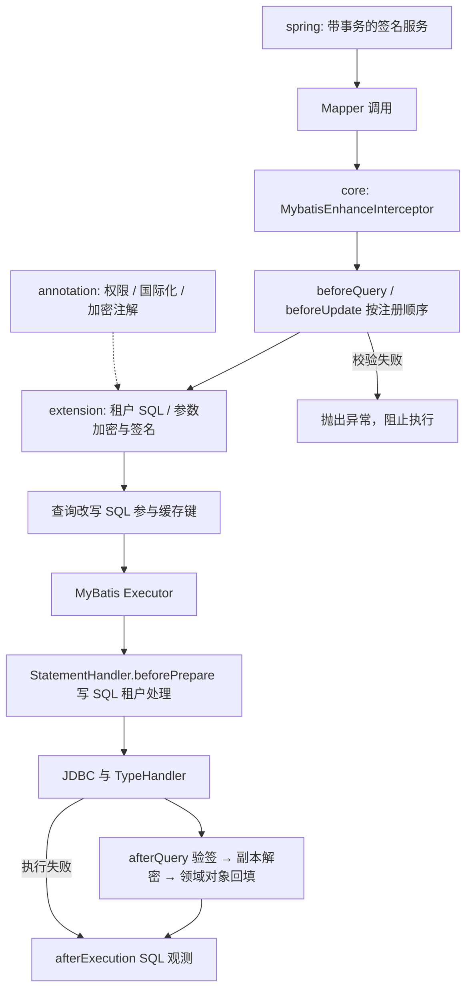

# 版本兼容策略

`mybatis-enhance` 的主版本与 Java 基线绑定，避免在同一版本线中混用不同字节码、语言特性和三方组件基线。

| 版本线     | Java 基线 | 依赖与代码约束                                                     | 当前状态    |
|---------|---------|-------------------------------------------------------------|---------|
| `1.0.x` | JDK 8   | Java 8 语法；JSqlParser 4.9；Jackson 2.22.4；Spring 5.3 | 当前维护分支 |
| `2.0.x` | JDK 17  | JSqlParser 5.3；Jackson 2.22.4；Spring 6.2 | 同步时单独验证 |
| `3.0.x` | JDK 21  | JSqlParser 5.3；Jackson 3.2.4；Spring 6.2；Maven 4 | 同步时单独验证 |

跨版本线同步以能力和公共契约一比一为目标，但依赖版本、Maven 编译配置、JSqlParser API 适配和 Java 语法必须分别符合对应 JDK
基线，不能机械复制构建配置。

JSqlParser 版本须与 DDD4J 对应维护线的 `ddd4j-dependencies/pom.xml` 一致：1.x 使用 4.9，2.x/3.x 使用 5.3（2026-11-24 核对）。升级时同时检查该依赖管理及 `ddd4j-data-mybatis` 的实际依赖，不单独选择另一版本。

## 共同维护契约

- 五个模块保持相同业务能力：annotation、core、extension、typehandler、spring。
- 统一增强链按注册顺序执行。查询 SQL 改写后重新生成缓存键；写 SQL 在 `beforePrepare` 处理。
- 验签读取缓存中的密文，解密返回独立对象，不将本次查询的明文写回一级缓存。
- `TenantLineInnerInterceptor` 统一接收租户列、共享表判断和租户值 Supplier；查询限制每个物理表，保留外连接语义。
- 单表 UPDATE/DELETE 追加租户条件；单行 VALUES INSERT 必须显式携带匹配的租户列，兼容字面量、Map/Bean 及标量参数。缺少租户或无法安全处理的写入拒绝执行。
- `TenantLineIntegrationTest`、`SqlParserContractTest`、加密签名集成测试及其余通用测试在三条线同步维护，各自在本线 JDK 上执行完整 `clean verify`。
- JSqlParser 4.9/5.3 的 Visitor API，以及 Jackson 2/3 的包名与配置方式保留必要差异；从旧 SQL AST 升级时，`SelectBody`/`SubSelect` 已改为 `Select`/`ParenthesedSelect`，直接调用这些第三方类型的消费者须重新编译。

## 主要调用关系

静态调用图用于定位，实际执行顺序由已注册的内部拦截器决定。SQLite 集成测试覆盖主流程，不替代生产数据库方言、其他插件组合或目标服务验收。

